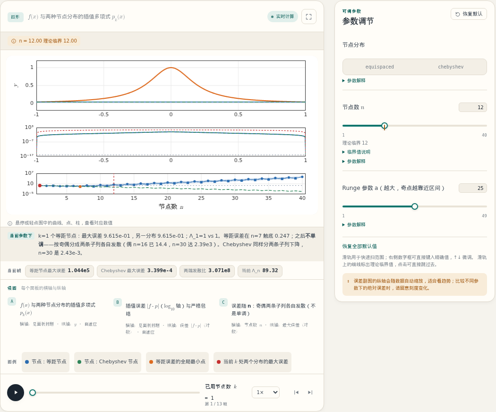
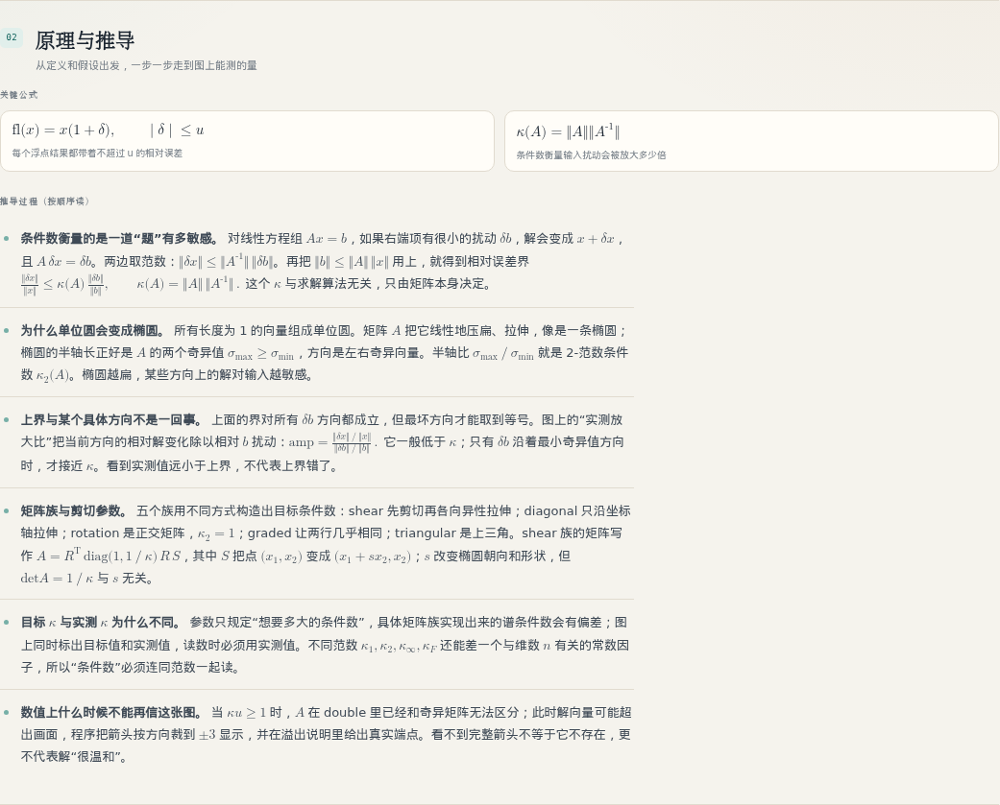

# 数值方法实验室

一套交互式数值分析教材。你可以在浏览器中调整参数、推进时间，观察算法的收敛过程、误差来源和失效边界。

共 **28 章、115 个交互实验**，内容从浮点数误差开始，覆盖数值线性代数、插值与逼近、数值积分、傅里叶分析、常微分方程、偏微分方程、优化与反问题。每个实验由可操作的图、参数控制、时间轴、分步推导和常见误读说明组成。



*图：图形、参数、时间轴和读数相互联动；调整参数或时间会触发重新计算。*

## 它适合谁

- 正在学习数值分析、计算方法或科学计算，希望把课堂公式与真实的浮点计算对应起来。
- 已经会使用某个算法，但对其适用条件和失效原因缺少直观认识。
- 从事工程仿真、数据分析或反问题，希望建立对条件数、收敛率、稳定域等概念的判断。

阅读前不要求先学完某本教材，但具备微积分和线性代数基础会更顺利。所有实验都在浏览器中打开，计算由本机的本地服务完成，不需要账号，也不会上传数据。

## 打开它

运行环境为 Python 3.11+ 和 Node.js 20+。首次使用时，在项目根目录执行：

```bash
python -m pip install -e .
npm install
npm run build
python -m server.app --port 8080
```

然后打开 <http://127.0.0.1:8080/>。结束使用后，在终端按 `Ctrl + C` 停止服务。

后续启动只需最后一条命令。端口被占用时可改用其他端口，例如 `--port 9000`。页面和计算都在本地完成；停掉服务不会影响已打开的页面，但重新获取计算结果需要服务处于运行状态。

Node.js 仅用于首次构建界面，运行阶段只需要 Python。公式由浏览器直接排版，不需要安装 LaTeX。

## 页面怎么用

### 左侧目录

章节按六个部分组织，点击即可切换。搜索框支持按章节标题或主题查找，按 `/` 或 `Ctrl/Cmd + K` 可直接聚焦搜索框。

右上角可切换浅色、深色或跟随系统主题。

### 实验切换

一章通常包含 4–5 个实验，使用编号卡片排列。点击卡片即可切换；每个实验有独立的图、参数和时间轴。

### 图形交互

- 将鼠标悬停在曲线、点、柱或热力格上，可查看对应数值；触屏设备可轻点。
- 图右上角提供全屏查看。
- 图下方说明各面板的横轴、纵轴、单位和图例。

### 参数控制

- 拖动滑杆可快速扫描整个取值范围。
- 右侧数字框可键入精确值：Enter 应用，Esc 取消，方向键微调。
- 滑杆上的细线标记理论临界值，点击可直接跳转。
- 展开「参数解释」可查看参数含义、调大或调小的影响，以及读图时应关注的部分。
- 带临界值的参数还会提供「临界值说明」，解释该阈值的作用。
- 「恢复全部默认值」可重置当前实验的参数。

### 时间轴

带过程演示的实验提供时间轴，支持拖动、播放/暂停、逐帧前进/后退和速度调整。静态实验不显示时间轴，调整参数即可重绘。

### 状态角标

图上方可能出现以下角标：

- **实时计算**：当前结果由本机服务按参数和时刻计算得到。
- **显示范围**：图形使用固定显示窗口时，超出窗口的内容被裁剪；角标会给出未显示部分的真实范围。
- **数据异常 / 溢出**：计算中出现非有限值、奇异矩阵或超出可表示范围的情况；图会绘制可用部分并说明缺失内容。
- **降级**：某个可选数据缺失，图会减少部分内容并说明原因。

将鼠标停在角标上，或使用键盘聚焦，可查看完整说明。

### 导出与分享

右上角的「导出与分享」支持：

- 保存当前图形为 PNG；
- 导出场景数据 JSON；
- 复制包含章节、实验、参数和时刻的分享链接。链接不包含计算结果，打开时会由本机重新计算。

PNG 只包含图形，不包含页面上的讲解文字。

## 每张图下面有什么

除图形外，每个实验还包含以下内容：

- **这张图在讲什么**：说明画面要回答的问题，并列出本章涉及的术语。
- **原理与推导**：给出关键公式，并按步骤说明从假设到图上可测量量的推导过程。
- **读图时，留意这些地方**：指出容易误读的现象，例如残差小不等于解准确、稳定不等于精确、超出显示范围不等于数据不存在。提醒较多时会折叠为「继续读」。
- **数据、坐标轴与技术细节**：说明数据来源、坐标轴是否自适应以及时间轴含义。



*图：推导部分给出完整过程，而不只是结论。*

## 从哪里开始

首次接触数值分析，可按以下顺序阅读：

**1.1 浮点数 → 1.2 线性方程组 → 1.3 最小二乘 → 2.1 插值 → 2.4 数值积分 → 3.1 单步法**

希望尽快进入偏微分方程和工程仿真：

**1.1 → 1.2 → 3.1 → 3.2 → 4.1 → 4.2 → 4.3 → 4.4**

关注数据、反问题和参数不确定性：

**1.1 → 1.3 → 5.1 → 5.2 → 5.4**

如果尚未确定阅读顺序，可使用左侧搜索，或从任意章节的第一个实验开始。各实验均可独立阅读。

## 内容地图

**第一部分 · 线性代数与矩阵计算**

1.1 浮点数、误差传播与问题条件 · 1.2 线性方程组直接法 · 1.3 最小二乘与正交化 · 1.4 特征值、伪谱与非正规性 · 1.5 稀疏迭代法与预条件

**第二部分 · 插值、逼近与积分**

2.1 插值与多项式逼近 · 2.2 样条与分段逼近 · 2.3 正交多项式与函数逼近 · 2.4 数值积分 · 2.5 傅里叶分析与 FFT · 2.6 小波与多分辨分析

**第三部分 · 微分方程与时间推进**

3.1 单步法、阶条件与自适应步长 · 3.2 稳定性与刚性方程 · 3.3 几何数值积分与长期行为 · 3.4 边值问题与谱方法 · 3.5 动力系统、分岔与混沌

**第四部分 · 偏微分方程与离散化**

4.1 抛物型方程与时间推进 · 4.2 双曲型方程：色散、耗散与限制器 · 4.3 守恒律与有限体积 · 4.4 有限元方法 · 4.5 多重网格与快速求解 · 4.6 谱方法与伪谱

**第五部分 · 反问题、优化与不确定性**

5.1 无约束优化与拟牛顿 · 5.2 反问题与正则化 · 5.3 伴随方法与灵敏度分析 · 5.4 不确定性量化与全局敏感性

**第六部分 · 综合与产出**

6.1 二维综合仿真 · 6.2 交互式教材打包与视频导出

## 常见问题

**为什么计算结果与理论值存在差异？**

实验使用 double 精度。表示误差、舍入误差以及问题本身的条件数都会使结果偏离精确值。第 1.1 章专门讨论这一问题；许多图同时给出误差曲线和理论上界，可用于判断差异是否仍在预期范围内。

**「显示范围」和「数据异常」有什么区别？**

「显示范围」表示图形采用固定坐标窗口，超出窗口的部分被裁剪；角标会说明被裁剪的内容和真实范围，数据本身通常没有问题。「数据异常」表示计算中出现了非有限值、奇异矩阵或超出可表示范围的情况，图会明确说明哪些部分无法绘制。

**页面一直停留在加载状态怎么办？**

先确认本地服务仍在运行，然后刷新页面。短暂断线时页面会自动重试；如果服务更换了端口，访问地址也需要相应修改。

**手机或平板可以使用吗？**

可以。页面会改为上下布局，图形、参数和讲解依次排列。较宽的图在横屏下更便于阅读。

**是否需要联网或上传数据？**

安装完成后不需要联网。所有计算和图形都在本机完成，参数和结果不会上传。

**能否替代 MATLAB、NumPy 或生产求解器？**

不能。这是一个教学实验室，问题规模、精度和参数范围都围绕理解方法而设计。生产计算仍需根据具体问题选择数值库、精度、容差和验证方案；本实验室更适合用于建立判断力。

**为什么有些实验没有时间轴？**

这些实验展示的是静态关系，例如误差随参数的变化、矩阵结构或收敛率。调整参数即可重绘，不需要时间轴。

## 说明

每个图形都由算法根据当前参数计算，不是预先录制的动画。无法绘制或只能部分绘制时，页面会说明原因，而不是显示可能造成误解的完整图形。

本实验室的目标，是让数值方法的计算过程、误差来源和适用边界可以被观察和检验。
